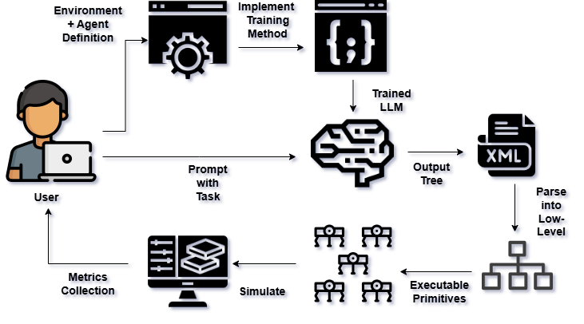

# MinionsLLM
Minions LLM es un marco de trabajo adaptativo a tareas para el control de sistemas multiagente a través del lenguaje natural, que integra grandes modelos de lenguaje con árboles de comportamiento y gramáticas formales para permitir el entrenamiento y control de sistemas multiagente en entornos arbitrarios definidos por el usuario. 

## Descargo de responsabilidad
Este marco de trabajo fue desarrollado para la investigación de mi tesis de maestría en la VU Amsterdam, bajo la supervisión del Dr. Eliseo Ferrante.
Para una explicación completa del marco de trabajo y los resultados experimentales, pueden consultar el artículo: 

https://doi.org/10.48550/arXiv.2508.08283

## Instalación

1. **Clonar el repositorio**:
    ```sh
    git clone https://github.com/andresgr96/MinionsLLM.git
    cd MinionsLLM
    ```

2. **Instalar el marco de trabajo (Linux)**:
    ```sh
    # Crear un entorno virtual
    python3 -m venv .venv
    source .venv/bin/activate

    # Instalar dependencias
    pip install -e .
    ```

## Introducción



MinionsLLM proporciona interfaces estandarizadas para definir entornos, agentes y primitivas de comportamiento, e introduce una metodología novedosa basada en gramáticas formales para la generación de conjuntos de datos sintéticos, con el fin de ajustar finamente (fine-tuning) los LLMs y mejorar su validez sintáctica y su rendimiento en las tareas. Paquetes principales:

– **LLM Interface**: Este paquete proporciona la funcionalidad para generar prompts a LLMs localmente utilizando diferentes opciones de backend para obtener árboles de comportamiento.

– **Agent Control**: Proporciona la funcionalidad para el control de agentes en un entorno simulado a través de árboles de comportamiento.

– **Tree Parser**: Actuando como middleware entre los paquetes de Interfaz y Control, proporciona la funcionalidad para analizar los árboles y convertirlos en comandos ejecutables para los agentes.

– **Dataset Grammar**: Proporciona la funcionalidad para generar conjuntos de datos personalizados a través de diferentes métodos.

## Uso

MinionsLLM proporciona varios scripts de ejemplo para ayudarle a comenzar con diferentes aspectos del marco de trabajo:

### 📁 Resumen de los ejemplos

#### **Ejemplos de prompting de interfaz** (`examples/01_interface_prompting_examples/`)
Aprenda cómo usar la interfaz de LLM para generar árboles de comportamiento a partir de indicaciones en lenguaje natural:

- **`llamacpp_example.py`** - Genera árboles de comportamiento utilizando el backend de LlamaCPP con modelos GGUF locales
- **`ollama_examples.py`** - Dos ejemplos que muestran cómo usar el backend de Ollama (modelos existentes + importación automática desde Hugging Face)
- **`saving_tree.py`** - Flujo de trabajo completo: generar prompt al LLM, crear el árbol de comportamiento y guardarlo como archivo XML

#### **Ejemplos de simulación** (`examples/02_simulation_examples/`)
Ejecute simulaciones de árboles de comportamiento en entornos robóticos:

- **`simulate_environment.py`** - Ejemplo completo para ejecutar una simulación de un robot con árboles de comportamiento

#### **Ejemplos de generación de datos** (`examples/03_data_gen_examples/`)
Explore la generación de conjuntos de datos sintéticos utilizando gramáticas formales:

- **`basic_dataset_generation.py`** - Generación simple de conjuntos de datos utilizando reglas gramaticales predeterminadas
- **`custom_grammar_gen.py`** - Genera conjuntos de datos utilizando configuraciones de gramática personalizadas
- **`filtered_dataset_generation.py`** - Generación avanzada de conjuntos de datos con filtrado basado en simulación
- **`mixed_gen.py`** - Generación mixta de conjuntos de datos que combina múltiples enfoques
- **`rlhf_dataset_gen.py`** - Generación interactiva de conjuntos de datos inspirada en RLHF con retroalimentación human-in-the-loop mediante una GUI unificada

#### **Ejemplos de configuración experimental** (`examples/04_experimental_setup_example/`)
Ejemplo completo de flujo de trabajo experimental para investigación y evaluación:

- **`generate_datasets.py`** - Genera conjuntos de datos integrales para la evaluación experimental
- **`run_experiment.py`** - Ejecuta experimentos completos con múltiples modelos y configuraciones
- **`compute_metrics.py`** - Analiza y calcula métricas de rendimiento a partir de los resultados experimentales
- **`upload_dataset.py`** - Sube los conjuntos de datos generados a Hugging Face Hub 

### 🚀 Inicio rápido

1. **Generar un árbol de comportamiento a partir de texto:**
   ```bash
    examples/01_interface_prompting_examples/saving_tree.py
   ```

2. **Ejecutar una simulación de un robot:**
   ```bash
    examples/02_simulation_examples/simulate_environment.py
   ```

3. **Generar conjuntos de datos de entrenamiento:**
   ```bash
    examples/03_data_gen_examples/basic_dataset_generation.py
   ```

### 📖 Descripciones de los ejemplos

- **Interface Prompting**: Utilice LLMs para convertir descripciones en lenguaje natural en árboles de comportamiento ejecutables
- **Simulation**: Ejecute árboles de comportamiento en entornos robóticos multiagente con simulación física
- **Data Generation**: Cree conjuntos de datos sintéticos para entrenar y ajustar finamente (fine-tuning) LLMs utilizando gramáticas formales

Cada ejemplo incluye comentarios detallados y documentación para ayudarle a comprender los componentes del marco de trabajo y adaptarlos a sus casos de uso específicos.

## Contribuciones

¡Damos la bienvenida a contribuciones para MinionsLLM! Para garantizar la calidad y consistencia del código, siga estas directrices:

### 🍴 1. Crear un fork y una rama

1. **Haga un fork del repositorio** en GitHub
2. **Clone su fork** localmente:
   ```bash
   git clone https://github.com/your-username/MinionsLLM.git
   cd MinionsLLM
   ```
3. **Cree una nueva rama** a partir de la rama `development` (no de `main`):
   ```bash
   git switch development
   git switch -c your-branch-name
   ```

### 🔧 2. Estándares de calidad de código

Antes de enviar sus cambios, asegúrese de que cumplan con nuestros estándares de calidad de código:

#### Instalar herramientas de calidad de código
```bash
# Instalar requisitos de calidad de código
pip install -r code_tools/requirements.txt
```

#### Verificar y corregir la calidad del código
Proporcionamos scripts automatizados para verificar y corregir problemas comunes:

```bash
# Verificar todos los problemas de calidad de código
./code_tools/fix_all.sh
```

#### Estándares de código que aplicamos
- **Black**: Formato de código consistente
- **isort**: Declaraciones de importación organizadas
- **MyPy**: Pistas de tipo (type hints) y comprobación estática de tipos
- **Darglint**: Documentación de parámetros en docstrings
- **Pydocstyle**: Cumplimiento del estilo de docstrings
- **Pyflakes**: Detección de importaciones y variables sin usar

### 📝 3. Enviar sus cambios

1. **Haga commit de sus cambios** con mensajes claros y descriptivos:
   ```bash
   git add .
   git commit -m "Add feature: clear description of what you added"
   ```

2. **Haga push a su fork**:
   ```bash
   git push origin your-branch-name
   ```

3. **Abra un Pull Request** hacia la rama `development` (NO hacia `main`)

### 🤖 Controles de calidad automatizados

Cuando abra un pull request, nuestras GitHub Actions ejecutarán automáticamente:
- Todas las herramientas de calidad de código
- Verificación de problemas de formato
- Validación de las pistas de tipo (type hints)
- Cumplimiento de los docstrings
- Ejecución de pruebas

**Su PR debe aprobar todos los controles automatizados antes de poder fusionarse.** Si algún control falla, verá los errores específicos y podrá corregirlos realizando push de commits adicionales a su rama.

### 🌟 Estrategia de ramas

- **`main`**: Código listo para producción, versiones estables
- **`development`**: Rama de integración para nuevas funcionalidades
- **Feature branches**: Contribuciones individuales (crear rama a partir de `development`)

Todas las contribuciones deben dirigirse a la rama `development`, la cual se fusiona periódicamente en `main` tras pruebas exhaustivas.

¡Gracias por contribuir a MinionsLLM! 🚀
